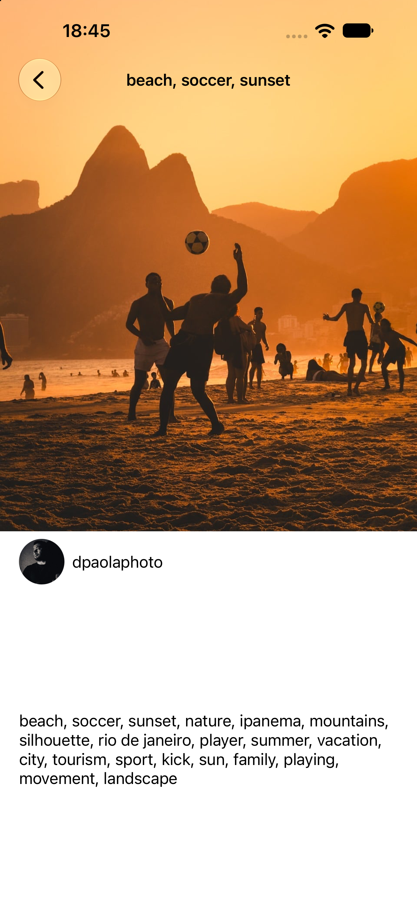

# FlickrApp

A photo discovery iOS application built with **Swift and UIKit**. The app fetches the latest photos from the [Pixabay API](https://pixabay.com/api/docs/), displays them in a table view, and allows users to search for photos and explore their details.

## Screenshots

<table>
  <tr>
    <td align="center" width="50%">
      
      <br>
      <strong>Recent Photos</strong>
    </td>
    <td align="center" width="50%">
      
      <br>
      <strong>Photo Detail</strong>
    </td>
  </tr>
</table>

## Features

- **Browse Recent Photos:** Fetch and display the latest photos from Pixabay.
- **Search Photos:** Search for photos using the integrated search bar.
- **Photo Details:** Select a photo to navigate to its detail screen.
- **Photo Information:** View the photo, its title, tags, and contributor information.
- **Profile Images:** Display contributor avatars alongside their photos.

## Technical Overview

### Networking

The app uses `URLSession` to communicate with the Pixabay API.

- `URLComponents` and `URLQueryItem` are used to construct API request URLs and query parameters.
- `URLSession.shared.dataTask` performs asynchronous network requests.
- `JSONDecoder` decodes API responses into Swift model types.
- `DispatchQueue.main.async` updates the UI on the main thread.

### API Integration

The application uses the Pixabay API endpoint:

```text
https://pixabay.com/api
```

The requests include the following parameters:

| Parameter | Description |
|---|---|
| `key` | Pixabay API key |
| `order` | Sort order (`latest`) |
| `image_type` | Image type (`photo`) |
| `q` | Optional search query |
| `id` | Photo ID used to retrieve a specific photo |

### Search

The recent photos screen uses `UISearchController` and conforms to `UISearchResultsUpdating`.

Search requests are triggered when the trimmed search text contains more than two characters. The entered text is passed to the Pixabay API through the `q` query parameter.

### Navigation

The app uses a Storyboard-based navigation flow.

1. `RecentPhotosTableViewController` fetches and displays photos.
2. When a photo is selected, the app triggers the `detailSegue`.
3. The selected photo's ID is passed to `PhotoDetailViewController` through `prepare(for:sender:)`.
4. The detail screen fetches the corresponding photo information using its ID.

### Image Loading

`NetworkManager` provides a shared instance for downloading image data.

It fetches contributor avatars and photo images using `URLSession`, then passes the downloaded `Data` to the corresponding image views.

## Project Structure

```text
FlickrApp/
├── App/
│   ├── Core/
│   │   └── Networking/
│   │       └── NetworkManager.swift
│   └── Delegates/
│       ├── AppDelegate.swift
│       └── SceneDelegate.swift
├── Screens/
│   ├── PhotoDetail/
│   │   ├── Controller/
│   │   │   └── PhotoDetailViewController.swift
│   │   └── View/
│   │       └── PhotoDetail.storyboard
│   └── RecentPhotos/
│       ├── Controller/
│       │   └── RecentPhotosTableViewController.swift
│       ├── Model/
│       │   ├── Photo.swift
│       │   └── PhotosResponse.swift
│       └── View/
│           ├── Base.lproj/
│           │   └── Main.storyboard
│           └── PhotoTableViewCell.swift
└── Supporting Files/
    ├── Assets.xcassets/
    ├── Base.lproj/
    │   └── LaunchScreen.storyboard
    └── Info.plist
```

## Technologies

- Swift
- UIKit
- URLSession
- Pixabay API
- JSONDecoder
- UITableView
- UISearchController
- Storyboard
- Xcode

## Getting Started

### Requirements

- macOS with Xcode
- A Pixabay API key

### API Key Configuration

The application reads the API key from an environment variable named `API_KEY`.

1. Create a free account on [Pixabay](https://pixabay.com/) and obtain an API key from your account.
2. Open the project in Xcode.
3. Select the `FlickrApp` scheme from the scheme selector.
4. Open **Product → Scheme → Edit Scheme...**
5. Select **Run** from the sidebar.
6. Open the **Arguments** tab.
7. Under **Environment Variables**, add a new variable:

   | Name | Value |
   |---|---|
   | `API_KEY` | Your Pixabay API key |

8. Make sure the variable is enabled and run the application.

The app reads the value with:

```swift
ProcessInfo.processInfo.environment["API_KEY"]
```

**Important:** Do not hardcode your API key in the source code or commit it to the repository. Environment variables configured in an Xcode scheme are suitable for local development, but they are not a secure way to protect secrets in a distributed production app.

## Learning Resources

This project was developed by following the [FlickrApp YouTube playlist](https://www.youtube.com/playlist?list=PLLU1VL2r9HKE).

## Learning Outcomes

- Fetching remote data using `URLSession`.
- Constructing API requests with `URLComponents` and `URLQueryItem`.
- Decoding JSON responses with `Codable` and `JSONDecoder`.
- Loading remote images asynchronously.
- Working with `UITableView`, custom table view cells, and data source methods.
- Implementing search with `UISearchController`.
- Passing data between view controllers using segues.
- Managing navigation with `UINavigationController`.
- Reading environment variables from an iOS application.