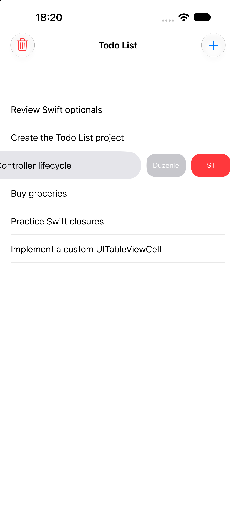

# Todo List App

A simple Todo List application built with **Swift and UIKit**. The app allows users to manage their tasks by adding, editing, and deleting list items. It uses **Core Data** to persist tasks locally, so the list remains available after closing and reopening the app.

## Screenshot

<p align="center">
  
</p>

## Features

- **Add Tasks:** Create new tasks using an alert with a text field.
- **List Tasks:** Display saved tasks in a `UITableView`.
- **Edit Tasks:** Swipe a list item to edit its title.
- **Delete Tasks:** Swipe a list item to delete it.
- **Remove All Tasks:** Delete all items after confirming the action.
- **Input Validation:** Prevent empty or whitespace-only tasks from being added or saved.
- **Persistent Storage:** Store tasks locally using Core Data.

## Technical Overview

### UIKit

- `UITableView` displays the list of tasks.
- `UITableViewDataSource` provides the number of rows and configures reusable cells.
- `UITableViewDelegate` handles table view interactions.
- `UIBarButtonItem` provides Add and Remove All actions.
- `UIAlertController` presents input, editing, warning, and confirmation alerts.
- `UIContextualAction` implements swipe-to-edit and swipe-to-delete actions.

### Core Data

The app uses Core Data for local persistence.

The data model contains a `ListItem` entity with one attribute:

| Entity | Attribute | Type |
|---|---|---|
| `ListItem` | `title` | String |

The `NSPersistentContainer` is configured in `AppDelegate`. The app accesses the managed object context to create, fetch, update, and delete task objects.

### Data Flow

1. When the screen loads, the app fetches existing tasks from Core Data.
2. The fetched managed objects are stored in the view controller's data array.
3. The table view displays the fetched items.
4. When a task is added, edited, or deleted, the context is updated and saved where necessary.
5. The table view is refreshed to reflect the latest data.

## Project Structure

```text
TodoListApp/
├── Controllers/
│   └── ViewController.swift
├── Views/
│   └── Base.lproj/
│       └── Main.storyboard
└── Supporting Files/
    ├── AppDelegate.swift
    ├── SceneDelegate.swift
    ├── Assets.xcassets/
    ├── Base.lproj/
    │   └── LaunchScreen.storyboard
    ├── TodoListApp.xcdatamodeld/
    └── Info.plist
```

## Technologies

- Swift
- UIKit
- Core Data
- UITableView
- UIAlertController
- Storyboard
- Xcode

## Learning Resources

This project was developed by following the [Todo List App YouTube playlist](https://www.youtube.com/playlist?list=PLQjWu60ESwhU).

## Learning Outcomes

- Working with `UITableView` and its delegate/data source protocols.
- Creating and configuring reusable table view cells.
- Implementing swipe actions with `UIContextualAction`.
- Presenting alerts and collecting user input with `UIAlertController`.
- Performing CRUD operations with Core Data.
- Working with `NSManagedObject`, `NSFetchRequest`, and `NSManagedObjectContext`.
- Managing local persistent data in an iOS application.